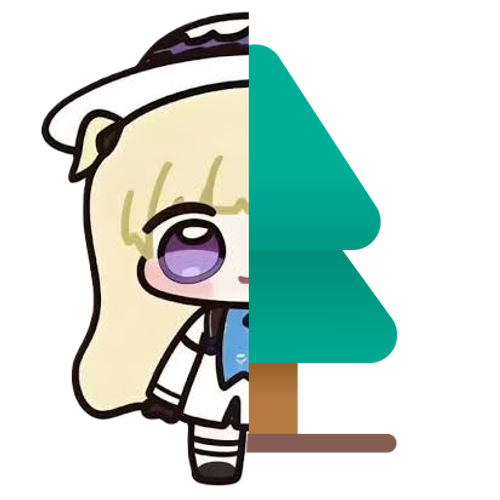
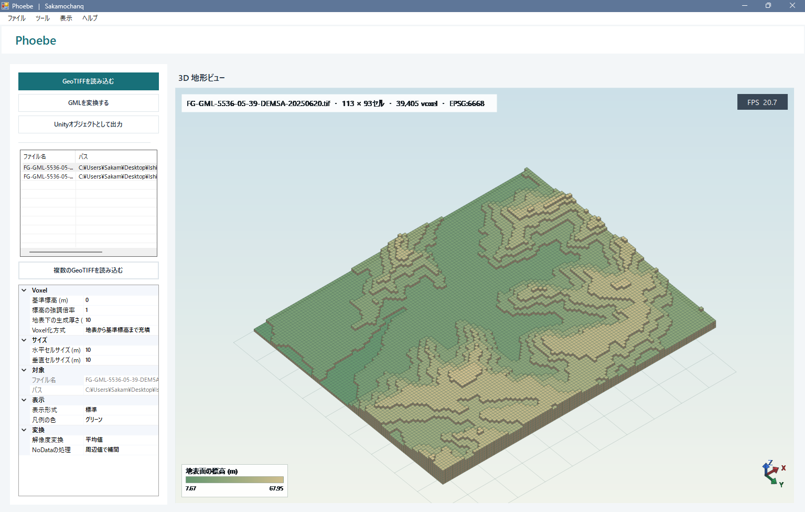
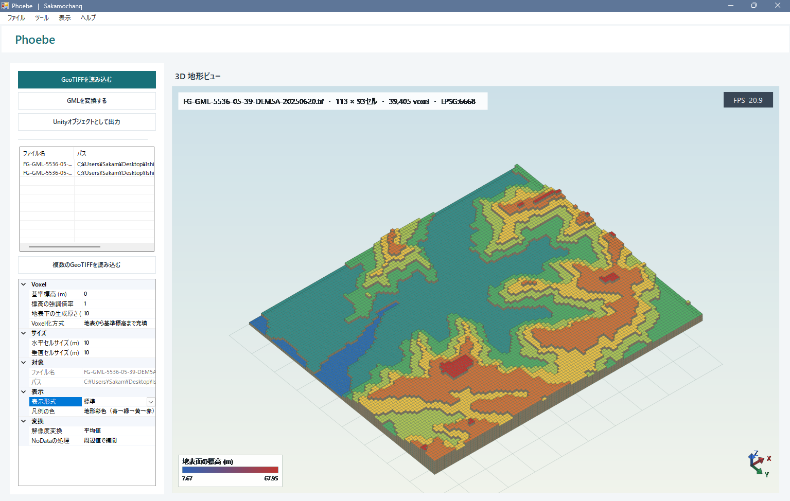
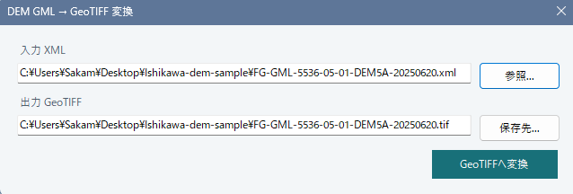
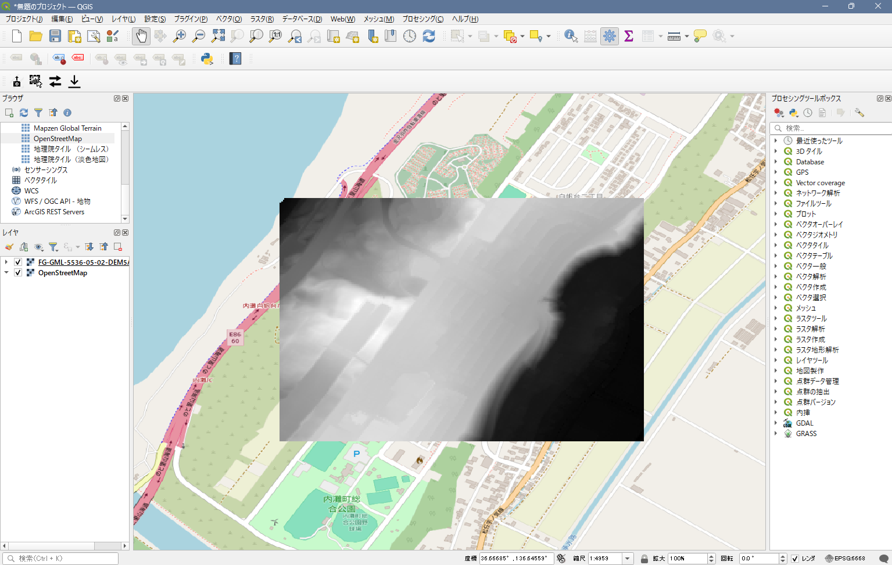
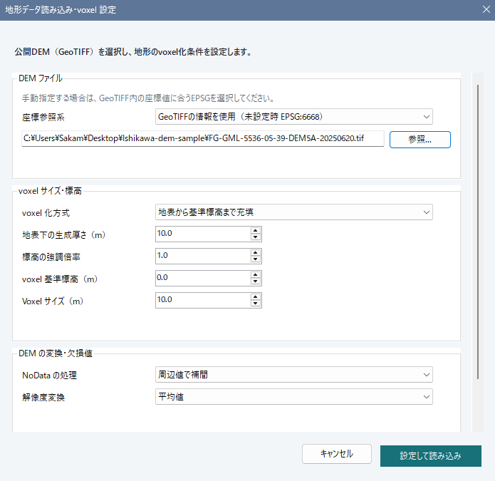

> Closed source code for **Phoebe**

<br>

<div align="center">
  <a href="#">
    
  </a>
  <h3><b>Phoebe</b></h3>
  <p>DEM を Unityで使用できる Voxel オブジェクト に変換するツール</p>
</div>

<hr>
<br>
<br>

<div align="center" style="display: flex; justify-content: center;">
  <a href="#">
    
    
  </a>
</div>

<br>
<br>


### 概要
**Phoebe** は、DEM (Digital Elevation Model) データを Unity で使用できる Voxel オブジェクトに変換するツールです。DEM データは、地形の標高情報を表すデータ形式であり、地理情報システム (GIS) や地形解析などで広く使用されています。**Phoebe** を使用することで、DEM データを簡単に Unity のゲームやシミュレーションに取り込むことができます。

<br>

### 開発背景

ゲームエンジンであるUnityでは、Project PLATEAUの公開都市モデルや基盤地図情報の地形データを活用したあらゆる災害シミュレーションや都市計画のシミュレーションを行うことができます。しかし、Unityにそのまま読み込んだDEM（地形データ）は扱いが難しい上、汎用性もあまりないと感じます。そこでDEMデータをVoxelで管理することで、地形の標高を視覚的に表現でき、より高精度な地形表現が可能になります。 

<br>

### 技術スタック

<table>
  <tr>
    <td>言語</td>
    <td>C#</td>
  </tr>
  <tr>
    <td>実行環境</td>
    <td>.NET Framework 4.7.2</td>
  </tr>
  <tr>
    <td>開発環境</td>
    <td>Visual Studio 2022</td>
  </tr>
</table>

<br>
<br>


### 使い方


1. **ダウンロード**

    Releaseタブから 最新版 **Phoebe** をダウンロードします。以下のリンクからダウンロード可能です。  <br>
    [最新版のダウンロード](https://github.com/yourusername/Phoebe/)

<br>
<br>

2. **DEMデータの準備**

    国土地理院の[基盤地図情報ダウンロードサービス](https://service.gsi.go.jp/kiban/app/map/)から、DEMデータをダウンロードします。ダウンロードする際には、必要な地域のデータを選択してください。ここでは、ファイル形式が`*.xml` or     `*.tiff` であることを確認してください。
   <br>
   <br>
    ```rb
    Example:
    FG-GML-5536-05-01-DEM5A-20250620.xml
    FG-GML-5536-05-02-DEM5A-20250620.xml
    FG-GML-5536-05-03-DEM5A-20250620.xml
    ```

<br>
<br>

3. **XMLを変換する**

    ダウンロードしたDEMデータが `*.xml` 形式の場合、**Phoebe** は GeoTIFF 形式に変換する必要があります。GeoTIFF 形式のデータを使用することで、より効率的に Voxel オブジェクトを生成できます。GeoTIFF 形式のデータは、国土地理院の基盤地図情報ダウンロードサービスから直接ダウンロードすることも可能です。
    <br>
    <br>
    画面 `GMLを変換する` をクリックし、専用の変換ツールを起動します。`入力XML`に、ダウンロードしたDEMデータのXMLファイルを指定し、`出力GeoTIFF`に変換後のGeoTIFFファイルの保存先を指定します。変換が完了すると、指定した場所にGeoTIFFファイルが生成されます。

    <br>
    <br>

    <div align="center">
      <a href="#">
        
        <h4>fig.1 変換ツール</h4>
      </a>
    </div>

    <br>

    変換したDEMファイル（*.tiff）は QGIS などの GIS ソフトウェアで開き、正しく変換されていることを確認してください。正しい座標で表示されていれば、**Phoebe** での変換が可能です。なお、通常の位置とはずれて表示されている場合は、座標参照系が正しく設定されていない可能性があります。QGIS で座標参照系を確認し、必要に応じて修正してください。

    <br>

    <div align="center">
      <a href="#">
        
        <h4>fig.2 QGISでDEMの表示</h4>
      </a>
    </div>

<br>
<br>

4. **GeoTIFFを読み込む**  

      `GeoTIFFを読み込む` をクリックし、任意の GeoTIFF ファイルを選択します。**Phoebe** は、選択した GeoTIFF ファイルを解析し、地形データを Voxel オブジェクトに変換します。パラメータを任意の値に設定し、`設定して読み込み` をクリックすると、Voxel オブジェクトがビューワーに表示されます。

      <br>

      <div align="center">
        <a href="#">
          
          <h4>fig.3 GeoTIFF読み込み時のパラメータ</h4>
        </a>
      </div>

      <br>

      <table>
        <tr>
          <td>座標参照系</td>
          <td>GeoTIFFの座標参照系を指定します。通常は、GeoTIFFファイルに含まれる座標参照系情報を使用します。</td>
        </tr>
        <tr>
          <td>表示方式</td>
          <td>地表から基準標高まで充填、地表面のみの描画など</td>
        </tr>
        <tr>
          <td>サイズ</td>
          <td>Voxelの1辺の長さを指定します。単位はメートルです。</td>
        </tr>
        <tr>
          <td>高さ倍率</td>
          <td>地形の高さを拡大する倍率を指定します。1.0の場合、元の高さがそのまま使用されます。</td>
        </tr>
        <tr>
          <td>表示範囲</td>
          <td>表示する地形の範囲を指定します。範囲外のデータは無視されます。</td>
        </tr>
      </table>

      > 基本的にデフォルトのままで問題ありません。

      <br>
      <br>

      <div align="center">
        <a href="#">
          
          <h4>fig.4 GeoTIFFのパラメータ</h4>
        </a>
      </div>

<br>
<br>

5. **Voxelオブジェクトの生成**

      3Dビューワーで、立体的に生成した Voxel オブジェクトを確認できます。必要に応じて、プロパティリストからパラメータを再設定できます。  <br><br>
      なお、Unityで使用する場合は、生成した Voxel オブジェクトをエクスポートし、Unityプロジェクトにインポートしてください。以下に手順を示しています。


<br>
<br>
<hr>
<br>

### Unityでの使用方法

1. **Unityプロジェクトの作成**

   Unity Hubを使用して、新しいUnityプロジェクトを作成します。プロジェクトのテンプレートは`「3D」`を選択してください。

<br>

2. **Phoebeのインポート**

   **Phoebe** でエクスポートしたフォルダの中に `Assets` が含まれています。この `Assets` フォルダを、Unityプロジェクトの `Assets` フォルダに上書きします。これにより、Phoebeプラグインをロードします。

<br>

3. **Voxelオブジェクトのインポート**

   Unityのメニューの **Phoebe>** をクリックします。`参照` をクリックし、**Phoebe** で生成した Voxel オブジェクトが記録されている `CSV（**/Assets/PhoebeVoxelExport/Data/voxels.csv）` を選択します。これにより、VoxelオブジェクトがUnityのシーンにインポートされます。

   <br>

> [!NOTE]  
> PLATEAUの都市モデルと同じ座標系で表示するには、座標のオフセットが必要です。PLATEAT SDK の モデル Inspector に表示されるオフセット値を入力して下さい。推奨PLATEAUオフセットを以下に示します。

   ```
   X = -74548.774320117431, Y = 45616.777950059986
   ```


<br>
<br>

### 著者

* [Sakamochanq](https://github.com/Sakamochanq)
  * [Codex](https://openai.com/ja-JP/codex/)
    * [GPT-6 Luna](https://openai.com/ja-JP/index/introducing-gpt-6-sol-and-luna/)

<br>
<br>

### 備考

> [!WARNING]  
> **Phoebe** は個人開発であり、変換結果の品質や精度、特定の用途への適合性を保証しません。利用前に、必ず変換結果を確認し、必要に応じて調整してください。利用は自己責任でお願いします。

<br>
<br>